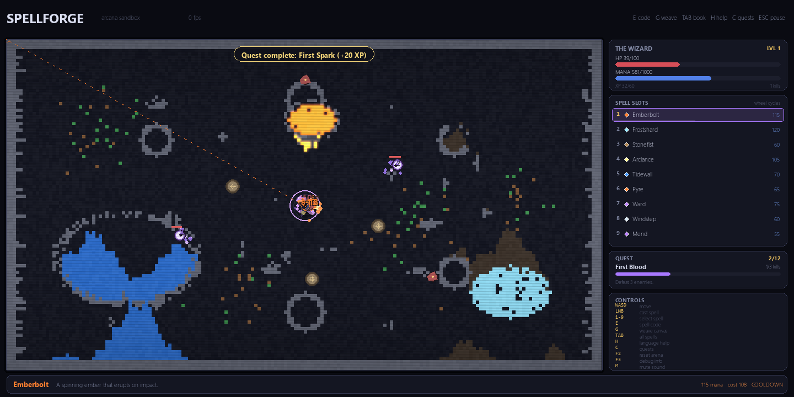
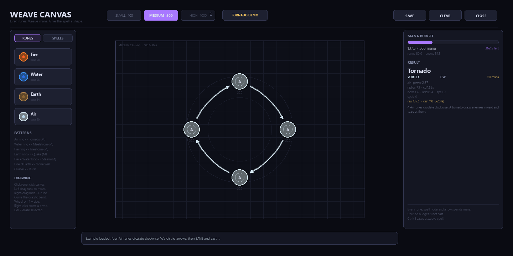

# SpellForge — Arcane Sandbox

Một sandbox phép thuật viết bằng **Python + Pygame**. Bạn không bấm nút để dùng phép có sẵn: bạn **viết phép bằng một ngôn ngữ nhỏ, nghiêm ngặt kiểu logic**, rồi ném nó ra thế giới vật lý để xem chuyện gì xảy ra.

- Thế giới mô phỏng dạng ô (falling-sand): nước, dầu, axit, lửa, băng, dung nham, hơi nước… tương tác với nhau.
- 12 phép mẫu, 1 phép weave mẫu, 10 loại nguyên tố, 10 loại câu lệnh (và weave canvas 4 nguyên tố).
- Kẻ địch, bia tập, khiên, trạng thái theo thời gian, nhiệm vụ tuần tự và hệ thống cấp độ.
- **Tutorial mở đầu** + chuỗi 12 nhiệm vụ: chỉ nhiệm vụ hiện tại mới có thể hoàn thành; phần thưởng cho XP và mở khóa canvas lớn hơn.
- **Cấp độ**: level 1 có 1000 mana; mỗi level cộng thêm 10% so với mức trước đó; XP đến từ hạ gục và hoàn thành nhiệm vụ.
- Trình soạn phép ngay trong game, biên dịch trực tiếp, báo lỗi `dòng:cột` kèm gợi ý.
- **Weave canvas (`G`)**: xây phép bằng cách kéo/thả các rune nguyên tố và vẽ mũi tên quan hệ; mana tiêu hao theo kích thước rune và chiều dài/độ cong mũi tên.




---

## 1. Cài đặt và chạy

Yêu cầu: **Python 3.10+** (đã kiểm tra với 3.12.10), `pygame`, `numpy`.

```powershell
cd E:\OPCode\spellforge
python -m venv .venv
.\.venv\Scripts\Activate.ps1
pip install -r requirements.txt
python run.py
```

Nếu đã có sẵn `.venv` trong thư mục:

```powershell
.\.venv\Scripts\python.exe run.py
```

> Nếu PowerShell chặn script kích hoạt: `Set-ExecutionPolicy -Scope Process Bypass`.

### Bản đóng gói sẵn (.exe, không cần Python)

1. Vào mục **Releases** của repo và tải `SpellForge.exe`.
2. Đặt file vào một thư mục bất kỳ rồi chạy. Không cần cài Python, không cần cài thêm gì.
3. Lần chạy đầu tiên, game tự tạo thư mục `spells/` cạnh file exe và chép 12 phép mẫu + weave Tornado vào đó.

```text
SpellForge\
├── SpellForge.exe
├── spells\            # tự sinh ở lần chạy đầu, sửa được
└── savegame.json      # tự sinh khi có tiến trình
```

- Game ưu tiên lưu cạnh exe (kiểu portable). Nếu thư mục đó không ghi được (ví dụ `C:\Program Files`), tiến trình và `spells/` được chuyển sang `%APPDATA%\SpellForge\`.
- Nếu game gặp lỗi khi khởi động, một hộp thoại hiện ra và chi tiết được ghi vào `spellforge_error.log` cạnh file exe.
- Windows SmartScreen có thể cảnh báo vì exe chưa ký số: chọn **More info → Run anyway**.

### Tự build exe

```powershell
pip install -r requirements-build.txt
python tools\build_exe.py
```

Kết quả là `dist\SpellForge.exe` (một file duy nhất, ~26 MB, không mở console). Script cũng vẽ icon và nhúng thư mục `spells/` vào trong exe.

### Nếu phím tắt không phản hồi

- Click vào **cửa sổ game** một lần để lấy focus bàn phím. Game sẽ hiện banner vàng *“Click the game window to focus the keyboard”* khi cửa sổ chưa có focus.
- Nếu vẫn không nhận phím, kiểm tra IME/Unikey đang bật hoặc cửa sổ terminal đang giữ focus thay vì cửa sổ game.
- Các phím tắt hoạt động ở trạng thái chơi bình thường: `H`, `C`, `TAB`, `E`, `G`, `ESC`, `F1`–`F3`.

### Tiến trình

Cấp độ, XP, nhiệm vụ đã hoàn thành, canvas đã mở khóa và thống kê được lưu trong `savegame.json` (cùng thư mục với `run.py`, hoặc cạnh `SpellForge.exe`). Muốn chơi lại từ đầu, hãy xóa file này.

---

## 2. Điều khiển

| Phím | Tác dụng |
| --- | --- |
| `WASD` / mũi tên | Di chuyển |
| Chuột trái | Ngắm và niệm phép (giữ để niệm liên tục khi hết hồi chiêu) |
| `1`–`9`, con lăn | Chọn phép |
| `E` | Mở trình soạn phép (code) |
| `G` | Mở weave canvas (xây phép bằng đồ thị) |
| `TAB` | Sổ phép (xem toàn bộ) |
| `H` / `F1` | Trợ giúp ngôn ngữ phép |
| `C` | Nhiệm vụ tuần tự (quest log) |
| `F2` | Tạo lại đấu trường (level, XP và nhiệm vụ được giữ) |
| `F3` | Thông tin debug |
| `M` | Bật/tắt âm thanh |
| `ESC` | Tạm dừng |

Trong trình soạn phép: `Ctrl+S` lưu, `Ctrl+N` tạo mới, `Ctrl+Z` / `Ctrl+Y` hoàn tác / làm lại, `F5` đọc lại từ đĩa, `Esc` đóng (tự lưu nếu có thay đổi).

Trong weave canvas: `LMB` đặt/chọn/kéo rune, `RMB` kéo từ rune này sang rune khác để vẽ mũi tên quan hệ, con lăn hoặc `[` `]` để đổi kích thước rune đang chọn, `Delete` xóa rune, `Ctrl+S` lưu, `Esc` đóng (tự lưu nếu hợp lệ).

---

## 3. Ngôn ngữ phép

Mỗi file `.spell` trong thư mục `spells/` chứa **đúng một phép**.

```spell
# Chú thích bắt đầu bằng dấu #
spell Fireball {
  mana 130
  cooldown 0.9
  desc "Một quả cầu lửa nổ tung khi chạm."

  cast {
    bolt fire speed=36 size=5 power=1.1 life=2.6 {
      on hit {
        burst fire radius=1.9 power=1.2
      }
    }
  }
}
```

### Cấu trúc

```
spell TênPhép {
  mana <số nguyên>          # bắt buộc, 1..300
  cooldown <giây>           # bắt buộc, 0.05..20
  desc "mô tả"              # tùy chọn
  cast { ... }              # đúng một khối cast
}
```

Quy tắc biên dịch (cố tình nghiêm ngặt):

- Chỉ một phép trong một file; tên phép chỉ gồm chữ, số, `_` và bắt đầu bằng chữ.
- `mana` **không được thấp hơn** chi phí ước lượng của chương trình. Trình biên dịch báo chi phí tối thiểu và gợi ý tăng `mana` hoặc giảm tham số.
- Mọi câu lệnh, nguyên tố, tham số phải tồn tại; sai tên sẽ có gợi ý bằng `difflib` (ví dụ `fier` → `fire`).
- Giá trị số phải nằm trong khoảng cho phép; tham số nguyên phải là số nguyên.
- Lỗi được báo theo `file:dòng:cột`, kèm `hint`.
- Một khối tối đa 24 câu lệnh; sự kiện lồng nhau tối đa 3 tầng.
- Các câu lệnh trong `cast` chạy tuần tự. `on hit` / `on expire` chỉ gắn được vào `bolt` (và `on hit` cho `beam`).

### Đơn vị

| Tham số | Đơn vị |
| --- | --- |
| `offset` | ô (tile) tính từ người niệm / điểm ngắm |
| `speed` | ô mỗi giây |
| `radius`, `length`, `height`, `size` | ô |
| `life`, `cooldown` | giây |
| `spread` | độ (tổng góc của chùm) |
| `power` | hệ số sức mạnh, `0.05..5` |

### Danh sách câu lệnh

| Câu lệnh | Nguyên tố | Tham số (mặc định — khoảng) | Sự kiện |
| --- | --- | --- | --- |
| `bolt` | có | `speed` 32 (4–90), `size` 4 (1–18), `power` 1 (0.05–5), `pierce` 0 (0–12, nguyên), `homing` 0 (0–8), `life` 2.5 (0.1–8), `offset` 1 (0–24) | `hit`, `expire` |
| `volley` | có | `count` 5 (1–40, nguyên), `spread` 16 (0–60), `power` 0.8, `speed` 30, `size` 3, `offset` 1 | — |
| `burst` | có | `radius` 2.5 (0.4–12), `power` 1, `offset` 0 (0–30) | — |
| `beam` | có | `length` 14 (2–90), `width` 1 (0.3–4), `power` 1, `offset` 0 (0–20) | `hit` |
| `wall` | có | `length` 6 (1–40), `height` 2 (1–10, nguyên), `life` 8 (0.5–30), `power` 1, `offset` 5 (0–20) | — |
| `orb` | có | `radius` 2.2 (0.4–10), `life` 3 (0.2–20), `power` 0.8, `offset` 5 (0–24) | — |
| `shield` | có | `radius` 2.2 (0.6–8), `life` 6 (0.5–30), `power` 0.8 | — |
| `dash` | — | `power` 7 (1–16) | — |
| `blink` | — | `distance` 10 (1–40) | — |
| `heal` | — | `amount` 25 (1–100) | — |

Ghi chú:

- `wall` chỉ dùng được với nguyên tố có vật liệu (xem bảng dưới).
- `dash` / `blink` di chuyển theo hướng ngắm và dừng khi gặp tường.
- `heal` hồi máu cho người niệm.
- `shield` chặn đạn của kẻ địch trong bán kính; mỗi lần chặn được tính vào nhiệm vụ `Bulwark`.
- `on hit` chạy khi đạn chạm kẻ địch/tường; `on expire` chạy khi đạn hết `life`. Nếu không có sự kiện, đạn vẫn gây một vụ nổ nhỏ khi hết hạn.

### Nguyên tố

| Nguyên tố | Hệ số sát thương | Vật liệu khi va chạm | Hiệu ứng chính |
| --- | --- | --- | --- |
| `fire` | 1.00 | lửa | Đốt cháy gỗ/cây/dầu, làm chảy băng, bốc hơi nước |
| `water` | 0.55 | nước | Dập lửa, làm nguội dung nham, làm ướt mục tiêu |
| `ice` | 0.75 | băng | Đóng băng nước, làm chậm kẻ địch |
| `earth` | 1.15 | đá | Sát thương vật lý nặng, tạo vật cản |
| `air` | 0.35 | — | Đẩy lùi kẻ địch |
| `lightning` | 1.35 | — | Truyền qua nước/mục tiêu ướt, sát thương rất cao |
| `poison` | 0.45 | axit | Tan chảy vật liệu rắn, gây độc theo thời gian |
| `arcane` | 1.10 | — | Sát thương ổn định, không phản ứng vật liệu |
| `light` | 0.85 | — | Sát thương tinh khiết |
| `dark` | 0.95 | — | Hút máu: hồi cho người niệm một phần sát thương |

### Phản ứng vật liệu

- `fire` + gỗ/cây/dầu → bắt cháy.
- `fire` + nước → hơi nước, lửa bị dập.
- `fire` + băng → tan thành nước.
- `water` + dung nham → đá + hơi nước.
- `axit` + đá/gỗ/băng → tan chảy.
- Phép `ice` + nước → đóng băng.
- `lightning` + nước hoặc mục tiêu ướt → sát thương ×1.5.
- Trạng thái `burn`, `poison`, `chill` gây sát thương theo thời gian và có thể giết kẻ địch.

---

## 4. Tutorial, nhiệm vụ tuần tự và cấp độ

### Tutorial

Lần chạy đầu tiên (hoặc sau khi xóa `savegame.json`) game mở màn hình hướng dẫn: di chuyển, niệm phép, nhiệm vụ tuần tự, weave canvas và luật mana. Click hoặc nhấn phím bất kỳ để bắt đầu.

### Nhiệm vụ tuần tự

Mở bằng `C`. Chỉ **nhiệm vụ hiện tại** mới được tính tiến độ; hoàn thành xong mới mở nhiệm vụ kế tiếp. Tiến độ được tính từ lúc nhiệm vụ bắt đầu, nên không thể "tick" sẵn các nhiệm vụ sau.

| # | Nhiệm vụ | Mục tiêu | Thưởng |
| --- | --- | --- | --- |
| 1 | First Spark | Niệm 1 phép | 20 XP |
| 2 | First Blood | Hạ 3 kẻ địch | 30 XP |
| 3 | Weaver's Apprentice | Lưu 1 phép trên weave canvas | 40 XP, mở **MEDIUM** |
| 4 | Closed Circuit | Lưu một weave có vòng kín | 50 XP |
| 5 | Storm Caller | Niệm một phép vortex | 45 XP |
| 6 | Pyromancer | Đốt 20 ô dễ cháy | 40 XP |
| 7 | Deep Freeze | Đóng băng 10 ô nước | 40 XP |
| 8 | Alchemist | Hòa tan 10 ô rắn bằng axit | 50 XP |
| 9 | Bulwark | Chặn 3 đạn địch bằng khiên | 40 XP |
| 10 | Overkill | Gây 80 sát thương trong một lần niệm | 60 XP, mở **HIGH** |
| 11 | Grand Ritual | Lưu weave tốn ≥ 500 mana vẽ (trước nén) | 70 XP |
| 12 | Architect | Viết và lưu một phép trong editor code (`E`) | 50 XP |

### Cấp độ và mana

- Level 1 có **1000 mana tối đa**.
- Phép viết bằng code tốn khoảng 55–120 mana; weave nhỏ tối đa 100, medium 500, high 1000.
- Khi cast, phép weave chỉ tốn **80% mana đã dùng để vẽ**.
- Mỗi level tiếp theo cộng **10% so với mức trước**: 1000 → 1100 → 1210 → 1331 → …
- XP đến từ hạ gục kẻ địch (Husk 12 XP, Watcher 18 XP) và hoàn thành nhiệm vụ.
- Lên level hồi đầy mana và tăng thanh mana tối đa.
- Tiến độ nhiệm vụ, level và canvas đã mở được lưu tự động vào `savegame.json`.

---

## 5. Trình soạn phép trong game (`E`)

- Soạn trực tiếp, biên dịch ngay khi gõ.
- Bảng **Compiler** hiển thị OK/lỗi, chi phí mana, cooldown, hệ nguyên tố.
- Lỗi được tô đỏ đúng dòng, kèm thông điệp và gợi ý.
- Lưu vào `spells/` và tự nạp lại sổ phép.
- Chặn trùng tên phép giữa các file.
- Tự lưu khi đóng nếu có thay đổi.
- Nút `RELOAD` đọc lại file từ đĩa; `NEW` tạo file mới từ mẫu.

---

## 6. Weave canvas (`G`) — xây phép bằng đồ thị

Đây là **prototype C**: chỉ mở 4 nguyên tố `fire`, `water`, `earth`, `air`, nhưng đúng hướng "luân chuyển mana" giữa các nguyên tố.

### Canvas và chi phí

| Cỡ | Mana | Kích thước | Mở khóa |
| --- | --- | --- | --- |
| `SMALL` | 100 | 560 × 420 | có sẵn |
| `MEDIUM` | 500 | 700 × 500 | hoàn thành nhiệm vụ 3 |
| `HIGH` | 1000 | 840 × 560 | hoàn thành nhiệm vụ 10 |

- Mỗi **rune** có chi phí `base(element) × size^1.8`. Con lăn trên rune hoặc `[` `]` với rune đang chọn để tăng/giảm kích thước; rune to hơn tốn mana hơn **và gây sát thương cao hơn**.
- Mỗi **mũi tên** có chi phí `6 + độ dài/40 + |độ cong| × 8`. Vẽ dài hoặc cong nhiều thì tốn hơn.
- Rune và mũi tên không được vượt budget của canvas; phần mana chưa dùng **không** bị trừ khi cast.
- Mũi tên cong được tạo bằng cách kéo chuột theo một cung; độ lệch của cung quyết định độ cong và chiều xoáy.
- Canvas lớn hơn mở ra không gian và ngân sách lớn hơn, nhưng mũi tên dài hơn cũng tốn nhiều mana hơn.

### Cách chơi

1. Chọn một nguyên tố ở cột trái.
2. Click lên canvas để đặt rune; kéo rune để di chuyển.
3. Giữ chuột phải, kéo từ rune nguồn sang rune đích để tạo quan hệ. Kéo theo cung để uốn mũi tên.
4. Con lăn hoặc `[` `]` để đổi kích thước rune đang chọn; `Delete` để xóa rune; chuột phải lên mũi tên để xóa.
5. Xem bảng **RESULT** bên phải: tên phép, dạng, **raw mana → cast mana**, sức mạnh, bán kính, chu kỳ.
6. `SAVE` ghi ra `spells/*.weave` (JSON). Phép xuất hiện trong sổ phép với nhãn `WEAVE`.
7. Chọn một phép `WEAVE` rồi nhấn `G` để mở lại đúng đồ thị cũ.

### Nén 20% và spell node

- Sau khi weave, phép được **nén 20%**: mana cần để cast = **80% mana đã dùng để vẽ** (làm tròn lên). Budget canvas và điều kiện nhiệm vụ vẫn tính theo mana vẽ (raw).
- Tab **SPELLS** trong palette liệt kê các phép weave đã lưu. Chúng có thể đặt xuống như một node.
- Spell node mở khóa khi **level ≥ 3** và đang dùng canvas **MEDIUM/HIGH**.
- Giá đặt spell node = `raw mana của phép con × size^1.3`. Khi phép cha được cast, phép con cũng được kích hoạt (nested casting) và hiệu ứng của nó scale theo kích thước node.
- Node càng to → tốn nhiều mana hơn → sát thương/phép con mạnh hơn.

### Các mẫu topology

| Đồ thị | Kết quả |
| --- | --- |
| 4 Air rune xếp vòng, mũi tên cong cùng chiều | **Tornado** — hút kẻ địch vào tâm và xoáy |
| 4 Water rune xếp vòng | **Maelstrom** |
| 4 Fire rune xếp vòng | **Firestorm** |
| 4 Earth rune xếp vòng | **Quake** |
| Vòng Fire + Water | **Steam Coil** |
| Các rune xếp thành đường thẳng | **Lance**, hoặc **Stone Wall** với Earth |
| Hai rune có một mũi tên | **Bolt** |
| Cụm rune không có vòng | **Burst** |

Chiều xoáy được tính từ hướng đi vòng của các mũi tên: cùng chiều kim đồng hồ → `CW`, ngược lại → `CCW`. Phép `Tornado` mẫu nằm ở `spells/13_tornado.weave` và chỉ xuất hiện sau khi mở khóa **MEDIUM**; nút `TORNADO DEMO` cũng chỉ dùng được từ lúc đó.

> Ở prototype này, "quan hệ nguyên tố" được suy ra từ **topology + nguyên tố của rune**, chưa có bảng chuyển hóa từng cặp (ví dụ `fire -> air` với tỉ lệ riêng). Đó là bước tiếp theo nếu muốn mô phỏng dòng mana chi tiết hơn.

---

## 7. Cấu trúc mã nguồn

```
spellforge/
  run.py                 điểm khởi chạy (xử lý cả bản .exe đóng gói)
  requirements.txt       pygame, numpy
  requirements-build.txt pyinstaller (chỉ khi build exe)
  tools/build_exe.py     tạo icon + đóng gói dist/SpellForge.exe
  savegame.json          tiến trình level/quest/canvas (tự tạo)
  spells/                12 phép mẫu (.spell) + 1 weave mẫu (.weave)
  spellforge/
    game.py              vòng lặp, input, niệm phép, quest, level, respawn
    spell_lang.py        lexer, parser, biên dịch, ước lượng chi phí
    runtime.py           thực thi phép, va chạm nguyên tố, sát thương
    world.py             vật liệu, mô phỏng falling-sand, tạo đấu trường
    entities.py          người chơi, kẻ địch, trạng thái
    effects.py           đạn, trường, khiên, hạt, vòng, tia, vortex
    render.py            vẽ thế giới, hiệu ứng, nhân vật
    ui.py                HUD, tutorial, quest log, sổ phép, tạm dừng
    editor.py            trình soạn phép bằng code
    weave.py             mô hình đồ thị nguyên tố, chi phí, phân giải topology
    weave_ui.py          canvas kéo/thả rune và mũi tên
    gfx.py               font, khung, thanh, chữ
    audio.py             hiệu ứng âm thanh tổng hợp (không cần file âm thanh)
    challenges.py        định nghĩa chuỗi nhiệm vụ
    config.py            hằng số, bảng nguyên tố
```

---

## 8. Mẹo nhanh

- Đốt dầu trước, rồi dùng lửa — dầu cháy lan rất nhanh.
- Đứng trong nước rồi dùng `lightning` sẽ tự chuốc họa; dụ kẻ địch xuống nước rồi giật.
- `Frostwall` chặn đạn và mua thời gian; băng sẽ tan dần.
- `Ward` + `Bulwark` là cách an toàn để hoàn thành nhiệm vụ khiên.
- Phép weave được nén 20% khi cast; dùng spell node ở level 3 để tái sử dụng phép đã weave.
- Nhiệm vụ chạy tuần tự; đừng cố làm trước nhiệm vụ sau, tiến độ chỉ tính từ lúc nhiệm vụ đó bắt đầu.
- `F2` tạo lại đấu trường nhưng **không** reset level, XP hay nhiệm vụ.
- Muốn chơi lại từ đầu: xóa `savegame.json`.
- `Emberbolt` có `on hit` nổ — tăng `radius` sẽ tốn mana hơn.
- Muốn thử nghiệm nhanh: sửa `mana` xuống thấp sẽ thấy lỗi biên dịch ngay; hãy tăng `mana` theo đúng chi phí được báo.

---

## 9. Giới hạn và hướng phát triển

- **Multiplayer chưa được triển khai.** Kiến trúc hiện tại chạy đơn người chơi, mô phỏng thế giới cục bộ. Hướng mở rộng khả thi: tách `World`/`Game` thành server authoritative, đồng bộ input + seed + sự kiện phép qua UDP/TCP, hoặc bản co-op cùng màn hình với hai bộ điều khiển.
- **Weave canvas mới là prototype 4 nguyên tố.** Chưa có bảng chuyển hóa mana theo từng cặp nguyên tố, chưa có phản phệ do chu trình quá tải, và chưa có editor đồ thị cho 6 nguyên tố còn lại.
- Tiến trình được lưu một file `savegame.json`; chưa có nhiều slot lưu hoặc tùy chọn reset trong game.
- Âm thanh là hiệu ứng tổng hợp đơn giản, không có nhạc nền.
- Bản `.exe` hiện chỉ build cho **Windows x64**. Chưa có bản macOS/Linux và chưa ký số nên SmartScreen có thể cảnh báo.

Chúc bạn viết ra những phép thuật thật khó chịu cho lũ Husk.
